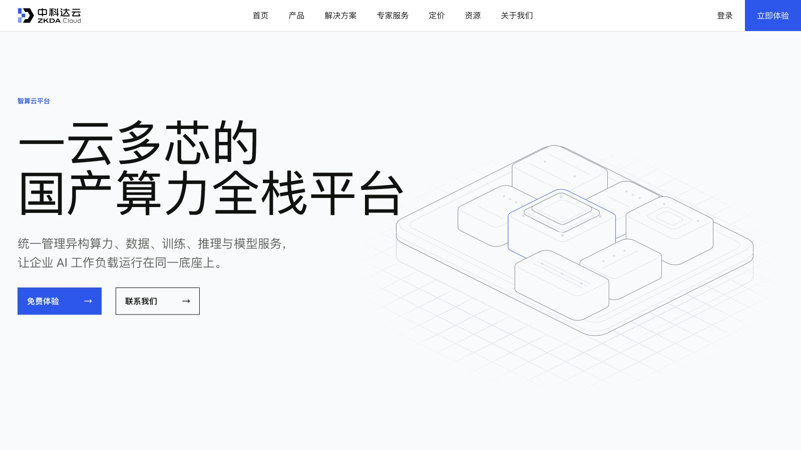

# 中科达云官网

中科达云国产算力基础设施官网，包含首页、智算云平台、Token Hub、AutoDev、解决方案、服务与资源页面。

[访问正式网站](https://zkda-cloud-homepage.mmmmqian.chatgpt.site)



## Product Hero V2.2

- 三产品共用 Technical Index、产品标签、响应式标题、Figure Metadata 与 Product Overview 结构。
- Desktop 保留各产品独立的大尺度 Figure 构图。
- Portrait 使用正常流 Figure Stage，并按实际 SVG ink bounds 计算单一 Owner 的尺寸与位置。
- 智算云、Token Hub、AutoDev 保留各自 Pointer、Active、Leave、Tour 与 reduced-motion 行为。
- Token Hub 当前正式 Figure 为 V5.4。
- 智算云 Resize 模式判断、Fit 与安全夹紧在同一 RAF 中原子提交。

## 本地运行

项目是无构建依赖的静态网站：

```bash
python3 -m http.server 8768 --bind 127.0.0.1
```

从仓库上一级目录启动时访问：

```text
http://127.0.0.1:8768/project002/
```

如果在本仓库根目录启动，则访问：

```text
http://127.0.0.1:8768/
```

## 发布目录

ChatGPT Sites 使用 `.openai/hosting.json`，静态发布目录为 `dist/`。修改公共源码后运行：

```bash
bash scripts/sync-dist.sh
```

该脚本将 `assets/`、`css/`、`js/`、`pages/` 与根 `index.html` 同步到 `dist/`。

## 目录

- `index.html`：首页
- `pages/`：产品、解决方案、服务与资源页面
- `css/`：全站与内容样式
- `js/`：全站交互及产品 Hero 适配器
- `assets/`：品牌、图片、图标和 Hairline Figure
- `dist/`：Sites 静态部署镜像
- `docs/`：设计规范与验证记录

## 运行依赖

- 现代浏览器
- Google Fonts 网络字体；无法加载时使用系统备用字体
- 无客户端密钥、数据库或服务端运行时

## 权利说明

本仓库当前未附加开源许可证，未明确授予复制、修改或再分发权利。
